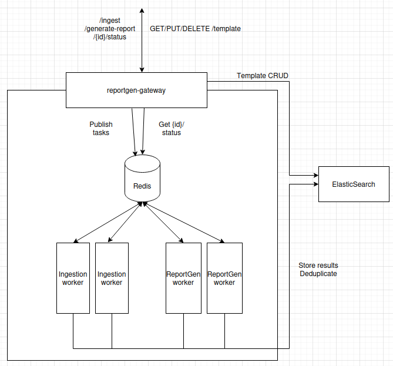

# document assembly with Gateway - Helm compatible API Backend Kubernetes-deployment

Minimal Helm documentation of the existing working Kubernetes manifests for the `document-assembly` stack.

## 0. Helm = templating + packaging + deploy

Key idea: Helm is not just templating.<br>
→ It can **render**, **package**, and **deploy** to Kubernetes.

Prerequisites for helm install:
- A running Kubernetes cluster
- A working kubeconfig
- Ability to reach the cluster (e.g. *"kubectl get nodes"* works)

Helm uses the Kubernetes API to **apply** the rendered manifests.

For more information:
- Documentation: http://documentation.<CLUSTER_IP>.nip.io/technos/helm/helm
- From the root of this project: additional-docs/helm.md

------------

This directory contains Helm charts and templates for deploying:
- The `document-gateway` as a Celery producer/api gateway in a Kubernetes cluster.
- The `document-importation-worker` as a Celery worker in a Kubernetes cluster.
- The `document-assembly-worker` as a Celery worker in a Kubernetes cluster.


## 1. Architecture

[](../refonte-document.png)

The system is composed of three main components:

**document-gateway**
- Exposes the API to external clients.
- Acts as a Celery producer: receives incoming requests and dispatches tasks to the Redis queue.
- Entry point for all document assembly and importation workflows.

**document-importation-worker**
- Consumes importation tasks from the Redis queue.
- Processes document importation: preprocessing, chunking, and indexing into the vector database (Qdrant/Elasticsearch).
- Manages shared storage access for document files and cache.

**document-assembly-worker**
- Consumes assembly tasks from the Redis queue.
- Executes the document assembly pipeline (LLM inference, etc.).
- Operates independently from the importation worker, allowing separate scaling.

**Redis** acts as the Celery broker and result backend, connecting all three components.


## 1'. Integration with document System

The importation worker integrates with:
- **document-gateway**: Receives importation tasks via Redis
- **Qdrant/Elasticsearch**: Stores document embeddings
- **LLM Service**: Uses LLM for text processing

The document assembly worker integrates with:
- **document-gateway**: Receives assembly tasks via Redis
- **Qdrant/Elasticsearch**: Queries document embeddings to retrieve relevant context
- **LLM Service**: Uses LLM for document assembly, citation extraction, and summary production
- **Shared storage (PVC)**: Reads preprocessed documents and writes generated document artifacts

Ensure all these services are accessible from the Kubernetes cluster.


## 2. Prerequisites

### Requirements
- Docker (28.0.2) (in order to pull images on the *Nexus Registry*, for local testing, see below)
- Kubernetes cluster (v1.20+)
- Helm (v3.19.0)

- Machine with GPUs to deploy<br>
  The document assembly pipeline relies on third-party LLMs deployed on **vLLM** - a high-throughput inference engine for large language models - configured via the common ConfigMap. For more information on how the vLLM Prod Stack is set up on our system:
  - http://documentation.<CLUSTER_IP>.nip.io/Utility/connect-to-vllm/
  - https://gitlab.internal.instance.com/infra/ml-forge/ml-forge-documentation/-/blob/main/06-VLLM-Prod.md
  - https://github.com/vllm-project/production-stack/tree/main/tutorials

- The pipeline also relies on **Qdrant** (vector database) and **Elasticsearch** for document storage and retrieval.
  - You will find the complete list of URLs for the services running on our server:
    - http://documentation.<CLUSTER_IP>.nip.io/Utility/server-links/
  - Qdrant useful url:
    - http://qdrant.genai.<CLUSTER_IP>.nip.io/dashboard#/collections/

- Redis cluster/service accessible from the Kubernetes cluster

### Deployment project
- GitLab: https://gitlab.internal.instance.com/group-example/document-deployment

### Docker registry access
- Registry: https://nexus.internal

- Documentation: https://gitlab.internal.instance.com/infra/ml-forge/ml-forge-documentation/-/blob/main/08-NexusUsage.md

- Docker registry access (`nexus.docker.registry`)

- `kubectl` configured with appropriate permissions (see below):
```bash
# 1) Authentication secret in the private registry
kubectl create secret docker-registry nexusdns \
  -n doc-assembler-depl \
  --docker-server=nexus.docker.registry \
  --docker-username=<USER> \
  --docker-password=<PASS>
```

Login (example from your local machine):
```bash
docker login nexus.docker.registry
```

Pull example (from your local machine):
```bash
docker pull nexus.docker.registry/document-assembly-gateway/document-gateway:v3.1.0
```

### Usage of a private library hosted on GitLab
- Documentation: ../README-using-common-package.md

### Versions

API backend DNS name: http://document-gateway.<CLUSTER_IP>.nip.io

Current delivery version: **v3.1.0**

| Component | Image version |
|-----------|--|
| `document-gateway` | `v3.1.0` |
| `import-worker` | `v3.1.0` |
| `docassembler-worker` | `v3.1.0` |

> Version tracking is currently maintained in a `images-version-tracking.txt` file at the root of the project. It will be migrated to a `.yaml` file in a future release.


## 3. Files included

- Namespace
- Common ConfigMap
- Shared assets PVC (static /hub, /config, :prompts)
- Gateway Ingress + Service
- Gateway + importation Worker + document assembly Worker Deployments
- Redis Service + StatefulSet
- Chart
- values
- _helpers

| File | Description |
|------|-|
| `templates/namespace.yaml` | Creates the shared namespace for all components (ALREADY EXIST) |
| `templates/configmap.yaml` | Shared configuration (Celery, database, LLM endpoints) |
| `templates/pvc.yaml` | PersistentVolumeClaim for shared storage (documents, cache) |
| `templates/ingress.yaml` | Ingress for external access to the gateway API |
| `templates/service.yaml` | Kubernetes Service for the document-gateway |
| `templates/deployments.yaml` | Deployments for document-gateway, importation worker, and document assembly worker |
| `templates/redis-service-statefulset.yaml` | Redis StatefulSet - Celery broker and result backend + Kubernetes Service exposing Redis within the cluster |
| `Chart.yaml` | Chart metadata (name, version, description) |
| `values.yaml` | Default configuration values - override at install time with `--set` or `--values` |
| `templates/_helpers.tpl` | Reusable template helpers - defines `fullname`, `name`, and common labels used across all templates |

About Deployments for:
- API gateway deployment: Celery producer, exposes the REST API
- importation worker deployment: processes and indexes documents
- assembly worker deployment - runs the document assembly pipeline


## 4. Chart structure

```yaml
mychart/
├─ Chart.yaml
├─ values.yaml
└─ templates/
   ├─ _helpers.tpl
   ├─ configmap.yaml
   ├─ deployments.yaml
   ├─ ingress.yaml
   ├─ namespace.yaml
   ├─ pvc.yaml
   ├─ redis-statefulset.yaml
 # ├─ secret.yaml
   └─ service.yaml
```


## 5. Quick start

Below, **v3.1.0** is a **release**.

Reminder; for more specific information on `Helm`:
- Documentation: http://documentation.<CLUSTER_IP>.nip.io/technos/helm/helm
- From the root of this project: additional-docs/helm.md

*Apply the following commands from the root of a `./helm-deployment` folder.*<br>
*This folder must contain a `./mychart` subfolder (see the Chart structure right above).*

Validate the structure and syntax & render locally:

```bash
# Validate the structure and syntax
helm lint ./mychart

# Render locally
helm template v3.1.0 ./mychart --namespace doc-assembler-depl
```

Install:

```bash
# Install only the namespace (if it doesn't exist)
helm template v3.1.0 ./mychart \
  --namespace doc-assembler-depl \
  --set namespace.create=true \
  --show-only templates/namespace.yaml \
| kubectl apply -f -
# Or:
kubectl create namespace doc-assembler-depl

# Then 
kubectl create secret docker-registry nexusdns \
  -n doc-assembler-depl \
  --docker-server=nexus.docker.registry \
  --docker-username='<USER>' \
  --docker-password='<PASS>'

# Finally install the rest of the Helm chart
helm install v3.1.0 ./mychart \
  --namespace doc-assembler-depl
  # --create-namespace \
  # -f ./mychart/values.yaml
```

Upgrade:

```bash
helm upgrade v3.1.0 ./mychart \
  --namespace doc-assembler-depl

# Or, if the previous `helm install` has failed
helm upgrade --install v3.1.0 ./mychart \
  --namespace doc-assembler-depl

# Apply a specific `values.yaml` file to your chart
helm upgrade --install v3.1.0 ./mychart \
  -n doc-assembler-depl \
  -f ./mychart/values.yaml

# Override your chart with another values file
helm upgrade --install v3.1.0 ./mychart \
  -n doc-assembler-depl \
  -f ./mychart/values.yaml \
  -f ./mychart/values-v3.1.0.yaml

helm upgrade --install v3.1.0 ./mychart \
  -n doc-assembler-depl \
  --set components.gateway.image.tag=v3.1.1

# Restart the running deployments pods after any upgrade
kubectl rollout restart deploy/import-worker-v3-1-0-deployment -n doc-assembler-depl
kubectl rollout restart deploy/docassembler-worker-v3-1-0-deployment -n doc-assembler-depl
kubectl rollout restart deploy/document-gateway-v3-1-0-deployment -n doc-assembler-depl

# Restart all in once
kubectl rollout restart deploy -n doc-assembler-depl

kubectl rollout status deploy/import-worker-v3-1-0-deployment -n doc-assembler-depl
kubectl rollout status deploy/docassembler-worker-v3-1-0-deployment -n doc-assembler-depl
kubectl rollout status deploy/document-gateway-v3-1-0-deployment -n doc-assembler-depl
```

Delete:
```bash
# Uninstall (delete resources for this release):
helm uninstall v3.1.0 -n doc-assembler-depl

# Delete all the components inside the namespace, without deleting the namespace itself
kubectl delete all --all -n doc-assembler-depl
kubectl delete ingress --all -n doc-assembler-depl
kubectl delete configmap --all -n doc-assembler-depl
kubectl delete pvc --all -n doc-assembler-depl
```

Check existing releases:
```bash
# List existing releases:
helm list -n doc-assembler-depl

# View history of releases
helm history document-assembly -n doc-assembler-depl
```


## 6. Monitoring

### Some basic commands

*See also exhaustive part 10 at the end of the following file:
`kubernetes-deployment/README-k8s-deploy.md`.*

```bash
# Check pods are running
kubectl get pods -n doc-assembler-depl

# Check logs
kubectl logs -n doc-assembler-depl -l app.kubernetes.io/name=import-worker

# Check Celery worker status (from a pod with celery installed)
kubectl exec -n doc-assembler-depl <pod-name> -- celery -A celery_tasks.celery_app inspect ping
```

### View Logs

```bash
# Stream logs from all workers
kubectl logs -n doc-assembler-depl -l app.kubernetes.io/name=import-worker -f

# Stream logs from a specific worker
kubectl logs -n doc-assembler-depl <pod-name> -f
```

### Check Worker Status
```bash
# List active workers
kubectl exec -n doc-assembler-depl <pod-name> -- celery -A celery_tasks.celery_app inspect active

# Check registered tasks
kubectl exec -n doc-assembler-depl <pod-name> -- celery -A celery_tasks.celery_app inspect registered

# Check stats
kubectl exec -n doc-assembler-depl <pod-name> -- celery -A celery_tasks.celery_app inspect stats

# Check the import/docassembler process into the Redis queue, from the Celery task ID associated with the process
kubectl exec -it -n doc-assembler-depl redis-0 -- redis-cli

# If the Celery backend is on DB 1
> SELECT 1

# Read a specific task from its ID
> GET celery-task-meta-<task-id>

# List all task IDs
> KEYS celery-task-meta-*

# Flush the Redis DB
> FLUSHDB

> exit
```


## 7. Important (about access to the `Nexus Registry`)

The chart expects the private registry pull secret to already exist by default:

```bash
kubectl create secret docker-registry nexusdns \
  -n doc-assembler-depl \
  --docker-server=nexus.docker.registry \
  --docker-username=<USER> \
  --docker-password=<PASS>
```

If you use another secret name, you could update:

```yaml
imagePullSecrets:
  existingSecrets:
    - your-secret-name
```


## 8. Useful endpoints for end-to-end functional tests

Reminder of the API DNS name: http://document-gateway.internal.example

> Full API specification is available as `openapi.json` at the root of this project.

Example data files for testing will be provided with this delivery:
- `abstract-afghanistan-2018-new.jsonl` - for testing `/import`
- `abstract-afghanistan-2018-new.json` - for testing `/generate-document`

### Endpoints

#### `POST /import`
Accepts a list of document references to import and prepare for document assembly.

Expected payload format:
```json
{
  "docs": [
    {
      "coreDataId": "a1b2c3d4-e5f6-7890-1234-567890abcdef",
      "coreType": "document",
      "coreDataSource": "Document Manager",
      "plainText": "La tension persiste dans les deux régions anglophones (...) de plusieurs témoins..."
    }
  ]
}
```

#### `GET /import/{coreDataId}/status`
Returns the current Celery status of an importation task.

#### `POST /generate-document`
Initiates the document assembly process using a template, document references, and context.

Expected payload format:
```json
{
  "docs": [
    {
      "coreDataId": "a1b2c3d4-e5f6-7890-1234-567890abcdef",
      "coreType": "document",
      "coreDataSource": "Document Manager"
    }
  ]
}
```

> Note: `/generate-document` does not require `plainText` - documents must have been previously imported via `/import`.

#### `GET /documents/{jobId}`
Retrieves the status of a specific document assembly job, along with its sections, citations, and source references.

#### `GET /health`
Health check endpoint used by Docker and Kubernetes liveness/readiness probes.

#### `POST /flush`
Attempts to flush files to empty the Qdrant DB, clearing preprocessing data and document data. Raises an error if the flush operation fails.


## 9. Main customization points (`values.yaml` file)

- namespace: `metadata.namespaceOverride`
- ingress host: `ingress.rules`
- images and tags: `components.*.image`
- replicas: `components.*.deployment.replicaCount`
- shared PVC size/class: `sharedAssets.*`
- Redis size: `redis.persistence.size`
- common env/config payloads: `config.*`

Inspect the usage of the VRAM:
```bash
gpu-available -d
```


## 10. Key results
Benchmark using **qwen3.6-35b**:

- **19 news items of variable length**
  - importation: ~ 1 min 55 sec
  - assembly: ~ 1 min 05 sec

- **20 news items of approximately one A4 page each**
  - importation: ~ 2 min 50 sec
  - assembly: ~ 1 min 15 sec

- **100 news items of approximately one A4 page each**
  - importation: ~ 13 min
  - assembly: ~ 2 min 23 sec


## 11. Notes

- The values structure intentionally stays close to the Helm templates structure.
- The chart keeps a single shared ConfigMap and a single shared PVC, matching the current raw manifests.
- `secret.yaml` is optional and only renders when `secrets` is non-empty (from the `values.yaml` file).


------------

### Author

AAllie
