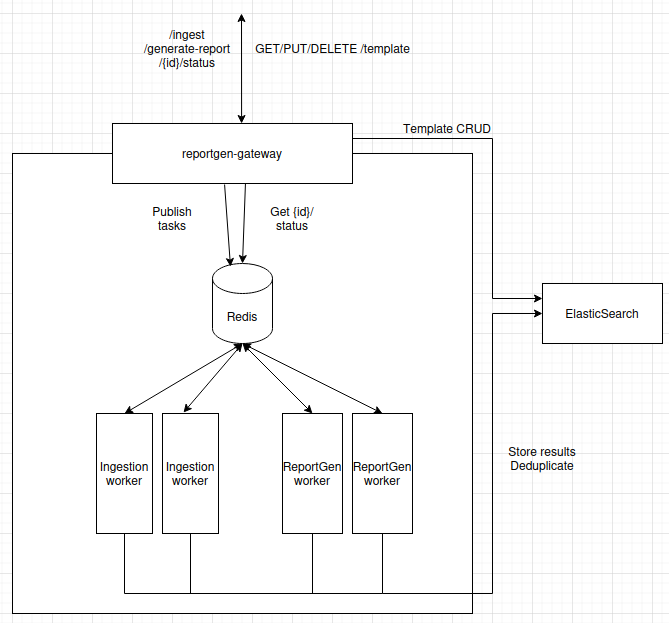

# document assembly with Gateway - Kubernetes API Backend Deployment

This directory contains Kubernetes manifests for deploying:
- The `document-gateway` as a Celery producer/api gateway in a Kubernetes cluster.
- The `document-importation-worker` as a Celery worker in a Kubernetes cluster.
- The `document-assembly-worker` as a Celery worker in a Kubernetes cluster.


## 1. Architecture

[](../refonte-document.png)

The system is composed of three main components:

**document-gateway**
- Exposes the API to external clients.
- Acts as a Celery producer: receives incoming requests and dispatches tasks to the Redis queue.
- Entry point for all document assembly and importation workflows.

**document-importation-worker**
- Consumes importation tasks from the Redis queue.
- Processes document importation: preprocessing, chunking, and indexing into the vector database (Qdrant/Elasticsearch).
- Manages shared storage access for document files and cache.

**document-assembly-worker**
- Consumes assembly tasks from the Redis queue.
- Executes the document assembly pipeline (LLM inference, etc.).
- Operates independently from the importation worker, allowing separate scaling.

**Redis** acts as the Celery broker and result backend, connecting all three components.


## 1'. Integration with document System

The importation worker integrates with:
- **document-gateway**: Receives tasks via Redis
- **Qdrant/Elasticsearch**: Stores document embeddings
- **LLM Service**: Uses LLM for text processing

The document assembly worker integrates with:
- **document-gateway**: Receives assembly tasks via Redis
- **Qdrant/Elasticsearch**: Queries document embeddings to retrieve relevant context
- **LLM Service**: Uses LLM for document assembly, citation extraction, and summary production
- **Shared storage (PVC)**: Reads preprocessed documents and writes generated document artifacts

Ensure all these services are accessible from the Kubernetes cluster.


## 2. Prerequisites

### Requirements
- Kubernetes cluster (v1.20+)
- Helm (v3.19.0)

- Machine with GPUs to deploy<br>
  The document assembly pipeline relies on third-party LLMs deployed on **vLLM** - a high-throughput inference engine for large language models - configured via the common ConfigMap. For more information on how the vLLM Prod Stack is set up on our system:
  - http://documentation.<CLUSTER_IP>.nip.io/Utility/connect-to-vllm/
  - https://gitlab.internal.instance.com/infra/ml-forge/ml-forge-documentation/-/blob/main/06-VLLM-Prod.md
  - https://github.com/vllm-project/production-stack/tree/main/tutorials

- The pipeline also relies on **Qdrant** (vector database) and **Elasticsearch** for document storage and retrieval.
  - You will find the complete list of URLs for the services running on our server:
    - http://documentation.<CLUSTER_IP>.nip.io/Utility/server-links/
  - Qdrant useful url:
    - http://qdrant.genai.<CLUSTER_IP>.nip.io/dashboard#/collections/

- Redis cluster/service accessible from the Kubernetes cluster

### Deployment project
- GitLab: https://gitlab.internal.instance.com/group-example/document-deployment

### Docker registry access
- Registry: https://nexus.internal

- Documentation: https://gitlab.internal.instance.com/infra/ml-forge/ml-forge-documentation/-/blob/main/08-NexusUsage.md

- Docker registry access (`nexus.docker.registry`)

- `kubectl` configured with appropriate permissions (see below):
```bash
# 1) Authentication secret in the private registry
kubectl create secret docker-registry nexusdns \
  -n doc-assembler-depl \
  --docker-server=nexus.docker.registry \
  --docker-username=<USER> \
  --docker-password=<PASS>
```

Login (example from your local machine):
```bash
docker login nexus.docker.registry
```

Pull example (from your local machine):
```bash
docker pull nexus.docker.registry/document-assembly-gateway/document-gateway:v3.1.0
```

### Usage of a private library hosted on GitLab
- Documentation: ../README-using-common-package.md

### Versions

API backend DNS name: http://document-gateway.<CLUSTER_IP>.nip.io

Current delivery version: **v3.1.0**

| Component | Image version |
|-----------|--|
| `document-gateway` | `v3.1.0` |
| `import-worker` | `v3.1.0` |
| `docassembler-worker` | `v3.1.0` |

> Version tracking is currently maintained in a `images-version-tracking.txt` file at the root of the project. It will be migrated to a `.yaml` file in a future release.


## 3. Files

| File | Description |
|------|-|
| `common/document-common-namespace.yaml` | Creates the shared namespace for all components (ALREADY EXIST) |
| `common/document-common-configmap.yaml` | Shared configuration (Celery, database, LLM endpoints) |
| `common/document-shared-assets-pvc.yaml` | PersistentVolumeClaim for shared storage (documents, cache) |
| `common/ingress.yaml` | Ingress for external access to the gateway API |
| `document-gateway/document-gateway-service.yaml` | Kubernetes Service for the document-gateway |
| `document-gateway/document-gateway-deployment.yaml` | API gateway deployment - Celery producer, exposes the REST API |
| `document-gateway/Dockerfile.assets` | Dockerfile assets for building the gateway image |
| `importation-worker/import-worker-deployment.yaml` | importation worker deployment - processes and indexes documents |
| `docassembler-worker/docassembler-worker-deployment.yaml` | assembly worker deployment - runs the document assembly pipeline |

| `redis/redis-statefulset.yaml` | Redis StatefulSet - Celery broker and result backend |
| `redis/redis-service.yaml` | Kubernetes Service exposing Redis within the cluster |


## 4. Deployment

### 1. Update Configuration

Before deploying, update the `document-common-configmap.yaml` with your environment-specific values:

```yaml
# Redis connection
CELERY_BROKER_URL: "redis://<redis-host>:6379/0"
# e.g. CELERY_BROKER_URL: "redis://redis.application.svc.cluster.local:6379/0"
CELERY_RESULT_BACKEND: "redis://<redis-host>:6379/1"

# Database (Qdrant)
DATABASE_URL: "http://<qdrant-host>:6333"
# e.g. DATABASE_URL: "http://qdrant.genai.<CLUSTER_IP>.nip.io:80"

# LLM endpoint
LLM_API_URL: "http://<llm-host>/v1"
LLM_MODEL: "your-model-name"
# e.g. LLM_API_URL: "http://vllm.<CLUSTER_IP>.nip.io/v1"
# e.g. LLM_MODEL: "gpt-oss-120b"
```

### 2. Apply Manifests
### First deployment - respect this order

*Apply the following commands from the root of a `./kubernetes-deployment` folder.*

```bash
# 0) Create namespace (ONLY IF DOESN'T EXIST)
kubectl apply -f common/document-common-namespace.yaml

# 1) Authentication secret in the private registry
kubectl create secret docker-registry nexusdns \
  -n doc-assembler-depl \
  --docker-server=nexus.docker.registry \
  --docker-username=<USER> \
  --docker-password=<PASS>

# 2) Common configuration - create ConfigMap
kubectl apply -f common/document-common-configmap.yaml -n doc-assembler-depl

# 3) Shared PVC (hub / prompts / some of config)
kubectl apply -f common/document-assembly-shared-assets-pvc.yaml -n doc-assembler-depl

# 4) Redis
kubectl apply -f redis/redis-service.yaml -n doc-assembler-depl
kubectl apply -f redis/redis-statefulset.yaml -n doc-assembler-depl

# 5) Deploy gateway
kubectl apply -f document-gateway/document-gateway-deployment.yaml -n doc-assembler-depl
kubectl apply -f document-gateway/document-gateway-service.yaml -n doc-assembler-depl

# 6) Deploy workers
kubectl apply -f importation-worker/import-worker-deployment.yaml -n doc-assembler-depl
kubectl apply -f docassembler-worker/docassembler-worker-deployment.yaml -n doc-assembler-depl

# 7) Ingress
kubectl apply -f common/ingress.yaml -n doc-assembler-depl

# Deploy all in once
cd ..
kubectl apply -f ./kubernetes-deployment
```

Or apply all at once:

```bash
kubectl apply -f .
```

### 3. Verify Deployment - example with the `import-worker` component

```bash
# Check pods are running
kubectl get pods -n doc-assembler-depl

# Check logs
kubectl logs -n doc-assembler-depl -l app.kubernetes.io/name=import-worker

# Check Celery worker status (from a pod with celery installed)
kubectl exec -n doc-assembler-depl <pod-name> -- celery -A celery_tasks.celery_app inspect ping
```


## 5. Scaling - example with the `import-worker` component

To scale the number of workers:

```bash
kubectl scale deployment import-worker-deployment -n doc-assembler-depl --replicas=5
```

Or update the `replicas` field in `import-worker-deployment.yaml`.


## 6. Monitoring

### Check Worker Status

```bash
# List active workers
kubectl exec -n doc-assembler-depl <pod-name> -- celery -A celery_tasks.celery_app inspect active

# Check registered tasks
kubectl exec -n doc-assembler-depl <pod-name> -- celery -A celery_tasks.celery_app inspect registered

# Check stats
kubectl exec -n doc-assembler-depl <pod-name> -- celery -A celery_tasks.celery_app inspect stats

# Check the import/docassembler process into the Redis queue, from the Celery task ID associated with the process
kubectl exec -it -n doc-assembler-depl redis-0 -- redis-cli

# If the Celery backend is on DB 1
> SELECT 1

# Read a specific task from its ID
> GET celery-task-meta-<task-id>

# List all task IDs
> KEYS celery-task-meta-*

# Flush the Redis DB
> FLUSHDB

> exit
```

### View Logs

```bash
# Stream logs from all workers
kubectl logs -n doc-assembler-depl -l app.kubernetes.io/name=import-worker -f

# Stream logs from a specific worker
kubectl logs -n doc-assembler-depl <pod-name> -f
```


## 7. Resource Configuration

The default resource allocation is:
- **Requests**: 10 CPU, 4Gi Memory
- **Limits**: 1 GPU, 8Gi Memory, (10% allocation of the total VRAM usage; unnecessary)

Adjust based on the workload in `import-worker-deployment.yaml`:

```yaml
resources:
  requests:
    cpu: "10000m"  # = 10 CPUs
    memory: "4Gi"
  limits:
    # cpu: "4000m"
    memory: "8Gi"
    # nvidia.com/gpu: "1"
    # nvidia.com/gpumem-percentage: 10  # 25
```

Inspect the usage of the VRAM:
```bash
gpu-available -d
```


## 8. Troubleshooting

### Worker Not Starting

1. Check pod status: `kubectl describe pod <pod-name> -n doc-assembler-depl`
2. Verify ConfigMap values are correct
3. Ensure Redis is accessible from the cluster

### Task Processing Issues

1. Check Celery logs for errors
2. Verify database connectivity
3. Ensure LLM endpoint is reachable

### Common Issues

| Issue | Solution |
|-------|----------|
| ImagePullBackOff | Verify image registry credentials and image name |
| CrashLoopBackOff | Check logs and ConfigMap configuration |
| Pending pods | Check resource availability and node selectors |


## 9. Useful endpoints for end-to-end functional tests

Reminder of the API backend DNS name: http://document-gateway.<CLUSTER_IP>.nip.io

> Full API specification is available as `openapi.json` at the root of this project.

Example data files for testing will be provided with this delivery:
- `abstract-afghanistan-2018-new.jsonl` - for testing `/import`
- `abstract-afghanistan-2018-new.json` - for testing `/generate-document`

### Endpoints

#### `POST /import`
Accepts a list of document references to import and prepare for document assembly.

Expected payload format:
```json
{
  "docs": [
    {
      "coreDataId": "a1b2c3d4-e5f6-7890-1234-567890abcdef",
      "coreType": "document",
      "coreDataSource": "Document Manager",
      "plainText": "La tension persiste dans les deux régions anglophones (...) de plusieurs témoins..."
    }
  ]
}
```

#### `GET /import/{coreDataId}/status`
Returns the current Celery status of an importation task.

#### `POST /generate-document`
Initiates the document assembly process using a template, document references, and context.

Expected payload format:
```json
{
  "docs": [
    {
      "coreDataId": "a1b2c3d4-e5f6-7890-1234-567890abcdef",
      "coreType": "document",
      "coreDataSource": "Document Manager"
    }
  ]
}
```

> Note: `/generate-document` does not require `plainText` - documents must have been previously imported via `/import`.

#### `GET /documents/{jobId}`
Retrieves the status of a specific document assembly job, along with its sections, citations, and source references.

#### `GET /health`
Health check endpoint used by Docker and Kubernetes liveness/readiness probes.

#### `POST /flush`
Attempts to flush files to empty the Qdrant DB, clearing preprocessing data and document data. Raises an error if the flush operation fails.


## 10. Key results
Benchmark using **qwen3.6-35b**:

- **19 news items of variable length**
  - importation: ~ 1 min 55 sec
  - assembly: ~ 1 min 05 sec

- **20 news items of approximately one A4 page each**
  - importation: ~ 2 min 50 sec
  - assembly: ~ 1 min 15 sec

- **100 news items of approximately one A4 page each**
  - importation: ~ 13 min
  - assembly: ~ 2 min 23 sec


## 11. Other useful commands
```bash
# Quick post-deployment check
kubectl get all -n doc-assembler-depl
kubectl get pvc -n doc-assembler-depl
kubectl get ingress -n doc-assembler-depl
kubectl get pods -n doc-assembler-depl -o wide


# Quick filters
kubectl get all -n doc-assembler-depl | grep doc-assembler
kubectl get pvc -n doc-assembler-depl | grep doc-assembler
kubectl get ing -n doc-assembler-depl | grep doc-assembler
kubectl get pods -n doc-assembler-depl | grep doc-assembler
kubectl get pods -n doc-assembler-depl | grep -E 'gateway|import|docassembler|redis'

kubectl get pods -n doc-assembler-depl | grep document-gateway
kubectl get pods -n doc-assembler-depl | grep import-worker
kubectl get pods -n doc-assembler-depl | grep docassembler-worker


# Overview
kubectl get ns
kubectl get all -n doc-assembler-depl
kubectl get ingress -A
kubectl get deploy,svc,ing,cm,pvc,secret -n doc-assembler-depl
kubectl get deploy,svc,ing,cm,pvc -A | grep doc-assembler


# Resource Inspection
# Deployments / StatefulSets / Services / Ingress
kubectl get deploy -n doc-assembler-depl
kubectl get sts -n doc-assembler-depl
kubectl get svc -n doc-assembler-depl
kubectl get ing -n doc-assembler-depl
kubectl get cm -n doc-assembler-depl
kubectl get pvc -n doc-assembler-depl

kubectl get deploy document-gateway-deployment -n doc-assembler-depl -o yaml
kubectl get deploy/import-worker-deployment -n doc-assembler-depl -o yaml
kubectl get deploy/docassembler-worker-deployment -n doc-assembler-depl -o yaml

kubectl describe deploy document-gateway-deployment -n doc-assembler-depl
# kubectl describe deploy/document-gateway-deployment -n doc-assembler-depl
kubectl describe deploy import-worker-deployment -n doc-assembler-depl
kubectl describe deploy docassembler-worker-deployment -n doc-assembler-depl
kubectl describe sts redis -n doc-assembler-depl
kubectl describe svc redis -n doc-assembler-depl
kubectl describe svc document-gateway-service -n doc-assembler-depl
kubectl describe ing document-assembly-gateway-ingress -n doc-assembler-depl
kubectl describe cm document-assembly-common-config -n doc-assembler-depl
kubectl describe pvc document-assembly-shared-assets-pvc -n doc-assembler-depl

# Useful events
kubectl get events -n doc-assembler-depl --sort-by=.metadata.creationTimestamp
kubectl get events -n doc-assembler-depl | tail -n 30
kubectl get events -n doc-assembler-depl --sort-by=.lastTimestamp | tail -20


# Deletion commands
# Resource by resource
kubectl delete deploy document-gateway-deployment -n doc-assembler-depl
kubectl delete deploy import-worker-deployment -n doc-assembler-depl
kubectl delete deploy docassembler-worker-deployment -n doc-assembler-depl
kubectl delete svc document-gateway-service -n doc-assembler-depl
kubectl delete svc redis -n doc-assembler-depl
kubectl delete ing document-assembly-gateway-ingress -n doc-assembler-depl
kubectl delete cm document-assembly-common-config -n doc-assembler-depl
kubectl delete pvc document-assembly-shared-assets-pvc -n doc-assembler-depl
kubectl delete sts redis -n doc-assembler-depl
# kubectl delete namespace doc-assembler-depl

# Delete all the components inside the namespace, without deleting the namespace itself
kubectl delete all --all -n doc-assembler-depl
kubectl delete ingress --all -n doc-assembler-depl
kubectl delete configmap --all -n doc-assembler-depl
kubectl delete pvc --all -n doc-assembler-depl


# File-based deletion
kubectl delete -f common/ingress.yaml -n doc-assembler-depl
kubectl delete -f document-gateway/document-gateway-service.yaml -n doc-assembler-depl
kubectl delete -f document-gateway/document-gateway-deployment.yaml -n doc-assembler-depl
kubectl delete -f importation-worker/import-worker-deployment.yaml -n doc-assembler-depl
kubectl delete -f docassembler-worker/docassembler-worker-deployment.yaml -n doc-assembler-depl
kubectl delete -f redis/redis-statefulset.yaml -n doc-assembler-depl
kubectl delete -f redis/redis-service.yaml -n doc-assembler-depl
kubectl delete -f common/document-assembly-shared-assets-pvc.yaml -n doc-assembler-depl
kubectl delete -f common/document-common-configmap.yaml -n doc-assembler-depl
kubectl delete -f common/document-common-namespace.yaml


# Pods
kubectl get pods -n doc-assembler-depl
kubectl get pods -n doc-assembler-depl -o wide
kubectl get pods -l app.kubernetes.io/name=document-gateway -n doc-assembler-depl -o wide

kubectl describe pod <pod-name> -n doc-assembler-depl
kubectl describe pod -l app.kubernetes.io/name=document-gateway -n doc-assembler-depl
kubectl describe pod -l app.kubernetes.io/name=import-worker -n doc-assembler-depl
kubectl describe pod -l app.kubernetes.io/name=docassembler-worker -n doc-assembler-depl
kubectl describe pod -l app.kubernetes.io/name=redis -n doc-assembler-depl

kubectl delete pod <pod-name> -n doc-assembler-depl
# Force delete
kubectl delete pod <pod-name> -n doc-assembler-depl --grace-period=0 --force


# See ReplicaSets of a deployment
kubectl get rs -n doc-assembler-depl | grep import-worker
kubectl get rs -n doc-assembler-depl | grep docassembler-worker
kubectl get rs -n doc-assembler-depl | grep document-gateway
kubectl get rs -n doc-assembler-depl | grep -E 'gateway|import|docassembler|redis'

# Delete useless/stopped old ReplicaSets
kubectl delete rs <rs-name> -n doc-assembler-depl


# Rollout commands
kubectl rollout status deploy/document-gateway-deployment -n doc-assembler-depl
kubectl rollout status deploy/import-worker-deployment -n doc-assembler-depl
kubectl rollout status deploy/docassembler-worker-deployment -n doc-assembler-depl
kubectl rollout status sts/redis -n doc-assembler-depl

kubectl rollout restart deploy/document-gateway-deployment -n doc-assembler-depl
kubectl rollout restart deploy/import-worker-deployment -n doc-assembler-depl
kubectl rollout restart deploy/docassembler-worker-deployment -n doc-assembler-depl


# Logs
kubectl logs <pod-name> -n doc-assembler-depl
kubectl logs <pod-name> -n doc-assembler-depl--tail=200
kubectl logs <pod-name> -f -n doc-assembler-depl # `-f` = follow
# kubectl logs -f <pod-name> -n doc-assembler-depl

kubectl logs <pod-name> -c document-gateway -n doc-assembler-depl --tail=200
kubectl logs <pod-name> -c import-worker -n doc-assembler-depl --tail=200
kubectl logs <pod-name> -c docassembler-worker -n doc-assembler-depl --tail=200
kubectl logs <pod-name> -c redis -n doc-assembler-depl --tail=200

kubectl logs <pod-name> -n doc-assembler-depl --previous --tail=200
kubectl logs <pod-name> -n doc-assembler-depl -c document-gateway --previous --tail=200

watch -n 5 'kubectl get pod <pod-name> -n doc-assembler-depl && kubectl describe pod <pod-name> -n doc-assembler-depl | tail -20'


# Per label logs
kubectl logs -l app.kubernetes.io/name=document-gateway -n doc-assembler-depl --tail=200
kubectl logs -l app.kubernetes.io/name=import-worker -n doc-assembler-depl --tail=200
kubectl logs -l app.kubernetes.io/name=docassembler-worker -n doc-assembler-depl --tail=200
kubectl logs -l app.kubernetes.io/name=redis -n doc-assembler-depl --tail=200

kubectl logs -f deploy/document-gateway-deployment -n doc-assembler-depl
kubectl logs -f deploy/import-worker-deployment -n doc-assembler-depl
kubectl logs -f deploy/docassembler-worker-deployment -n doc-assembler-depl
```


## 12. Redeployment:
```bash
kubectl scale deploy/document-gateway-deployment -n doc-assembler-depl --replicas=0
kubectl scale deploy/document-gateway-deployment -n doc-assembler-depl --replicas=1

kubectl set image deploy/document-gateway-deployment \
  -n doc-assembler-depl \
  document-gateway=nexus.docker.registry/document-assembly-gateway/document-gateway:v3.1.0

kubectl rollout restart deploy/document-gateway-deployment -n doc-assembler-depl
kubectl rollout status deploy/document-gateway-deployment -n doc-assembler-depl

# Restart all in once
kubectl rollout restart deploy -n doc-assembler-depl
```


## 13. How to quickly update static files (hub, prompts, config)

### Option 1 - delete / reset the PVC contents (into the Kubernetes cluster)
```bash
# Go into the temporary pod mounted on the PVC
kubectl run pvc-shell --rm -it -n doc-assembler-depl --image=ubuntu --overrides='{"spec":{"containers":[{"name":"sh","image":"ubuntu","command":["bash"],"stdin":true,"tty":true,"volumeMounts":[{"name":"shared","mountPath":"/mnt/shared"}]}],"volumes":[{"name":"shared","persistentVolumeClaim":{"claimName":"document-shared-assets-pvc"}}]}}'

# Delete the .assets-version file
rm -f /mnt/shared/.assets-version
# Or empty the PVC
find /mnt/shared -mindepth 1 -delete

exit

# Then restart the pod so that initContainer copies
kubectl rollout restart deploy/document-gateway-deployment -n doc-assembler-depl
kubectl rollout status deploy/document-gateway-deployment -n doc-assembler-depl
```

### Option 2 - Change the seeding logic to enable versioned updates
```bash
# docker build -t nexus.docker.registry/document-assembly-gateway/document-shared-assets:v3.1.0 -f ./kubernetes-deployment/document-gateway/Dockerfile.assets ../document-gateway/
cd ../document-gateway
docker build -t nexus.docker.registry/document-assembly-gateway/document-shared-assets:v3.1.0 -f Dockerfile.assets .

docker push nexus.docker.registry/document-assembly-gateway/document-shared-assets:v3.1.0

kubectl set image deployment/document-gateway-deployment \
  -n doc-assembler-depl \
  seed-shared=nexus.docker.registry/document-assembly-gateway/document-shared-assets:v3.1.0

# Then:
kubectl set env deployment/document-gateway-deployment \
  -n doc-assembler-depl \
  ASSETS_VERSION=v3.1.0

kubectl rollout status deployment/document-gateway-deployment -n doc-assembler-depl
```

### Option 3 - For rapid development, do not use the PVC for some of the configuration
```bash
# Keep hub and prompts (static conf) in the PVC/assets (mnt/shared) folder,
# but mount the "not static" conf (e.g. configs/api/settings.yaml) with ConfigMap.
kubectl apply -f common/document-common-configmap.yaml -n doc-assembler-depl

kubectl rollout restart deploy/document-gateway-deployment -n doc-assembler-depl
kubectl rollout status deploy/document-gateway-deployment -n doc-assembler-depl

kubectl rollout restart deploy/import-worker-deployment -n doc-assembler-depl
kubectl rollout status deploy/import-worker-deployment -n doc-assembler-depl

kubectl rollout restart deploy/docassembler-worker-deployment -n doc-assembler-depl
kubectl rollout status deploy/docassembler-worker-deployment -n doc-assembler-depl

# Restart all in once
kubectl rollout restart deploy -n doc-assembler-depl
```

------------

### Author

AALLIE
