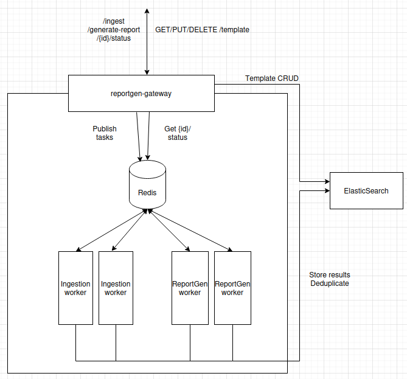

# document assembly System

Asynchronous document processing and document assembly pipeline built on **FastAPI**, **Celery**, and **Redis**. The system enables automated creation of structured documents using customizable templates with source traceability.

The architecture is distributed: a FastAPI gateway enqueues tasks into a Redis message broker, and dedicated Celery workers (`document-importation-worker`, `document-assembly-worker`) consume and process them asynchronously, enabling horizontal scaling and workload decoupling.

---

## Architecture Overview

The document assembly System follows a **distributed, service-oriented architecture** designed for high-throughput, asynchronous document processing. The FastAPI gateway acts as a task producer, dispatching work to Redis queues consumed by independent Celery workers.



### Component Repositories

| Component | Repository | Description |
|-----------|-----------|-------------|
| **document-gateway** | `document-gateway/` | FastAPI application — receives HTTP requests, enqueues Celery tasks |
| **document-importation-worker** | `document-importation-worker/` | Celery worker — imports and chunks documents |
| **document-assembly-worker** | `document-assembly-worker/` | Celery worker — generates documents from templates |
| **document-common** | `document-common/` | Shared library — schemas, services, utilities used by all components |
| **document-deployment** | `document-deployment/` | Deployment configuration — Docker Compose, Helm, Kubernetes |

### Key Components

**API Layer (FastAPI Producer):** RESTful API providing endpoints for document importation, document assembly, template management, and system operations. The API does **not** process long-running tasks itself — it enqueues them via Celery to Redis and returns immediately with a `202 Accepted` status. Status polling endpoints allow clients to track progress.

**Celery Workers (Consumers):** Two independent Celery workers, each running in their own container/repository, consume tasks from dedicated Redis queues:
- `document-importation-worker`: processes document importation tasks
- `document-assembly-worker`: processes document assembly tasks

This separation allows independent scaling, deployment, and failure isolation.

**Redis (Message Broker & Result Backend):** Redis serves as both the Celery message broker (transporting tasks from producer to workers) and the result backend (storing task status and results for polling).

**Citation System:** Advanced multi-stage pipeline for citation extraction, ranking, validation, and confidence scoring with complete source traceability.

**Template Engine:** YAML-based template system supporting section-based document assembly with flexible prompting strategies.

---

## Technology Stack

- **API Framework**: FastAPI 0.115.11+ for high-performance async web services
- **Core Framework**: Haystack AI 2.11.2+ for document processing and vector operations
- **Task Queue**: Celery 5.6.2+ for distributed task processing
- **Message Broker**: Redis 7.3.0+ (broker + result backend)
- **Document Processing**: Tika integration, Python-docx, multi-format support
- **Vector Storage**: Qdrant, Elasticsearch, or InMemory backends
- **LLM Integration**: OpenAI API, vLLM, Ollama compatibility
- **Shared Library**: `document-common` for cross-service schemas, services, and utilities
- **Configuration**: YAML-based configuration system

---

## Deployment

> **Note:** For deployment instructions, Docker Compose configurations, and Kubernetes/Helm charts, please refer to the **`document-deployment`** repository. The README files in this repository describe the component architecture and API only.

---

## API Reference

Complete API specifications are maintained alongside the code:
- **Route structure & module overview** → [api_gateway/README.md](api_gateway/README.md)
- **OpenAPI specification (latest)** → [api_gateway/doc/openapi.yaml](api_gateway/doc/openapi.yaml)

---

## Configuration

System configuration is managed through YAML files in `config/configs/`:

### Database Configuration (db_setup.yaml)

```yaml
database: qdrant  # qdrant, elasticsearch, inmemory
url: "http://qdrant-host:6333"
indexes:
  sections: { name: "sections" }
  documents: { name: "documents" }
  files: { name: "files" }
  documents: { name: "documents" }
embed_chunks: true
```

### LLM Configuration (llm_config.yaml)

```yaml
api_url: "http://llm-endpoint/v1"
model: "model-name"
temperature: 0.70
max_output_tokens: 8192
timeout: 10000.0
top_p: 0.8
```

---

## Remote API Compatibility

The document assembly System is compatible with **any** OpenAI API endpoint provider, whether local or remote, provided adequate resources are available.

### Configuration Examples

**OpenAI Cloud API:**
```yaml
api_url: "https://api.openai.com/v1"
model: "gpt-4"
api_key: "sk-your-openai-api-key"
temperature: 0.70
max_output_tokens: 8192
timeout: 10000.0
```

**vLLM Self-Hosted:**
```yaml
api_url: "http://vllm-server:8000/v1"
model: "meta-llama/Llama-2-70b-chat-hf"
temperature: 0.70
max_output_tokens: 8192
timeout: 30000.0
```

### Resource Considerations

**Network Connectivity:** Ensure stable network connection to remote endpoints, configure appropriate timeouts for long-running operations, and consider bandwidth requirements for large model interactions.

**Scalability Planning:** Remote API rate limits may constrain system throughput while local deployments offer unlimited usage but require infrastructure scaling.

---

## Documentation and Support

### Detailed Documentation

For comprehensive setup and usage guides:
- [Getting Started Guide](docs/getting-started/quick-start.md)
- [Installation Guide](docs/getting-started/installation.md)
- [First document Tutorial](docs/getting-started/first-document.md)
- [Complete API Documentation](docs/api/overview.md)

### Support Channels

- Development team: Contact for network access and infrastructure support
- DMZ environment assistance available
- Configuration troubleshooting and optimization guidance

### Infrastructure Deployment Guides

- [Docker Compose Deployment](../document-deployment/README-docassembler-system.md) — full stack deployment
- [Kubernetes Helm Deployment](docs/infrastructure/helm.md) — Production-ready Kubernetes deployment for Qwen 32B using Helm charts

---

## Version Information

Current Version: 3.1.0
Target Release: Production v3.1.0
Last Updated: 2026-05-05

For production deployment questions or infrastructure support, contact the development team for DMZ network configuration and optimization guidance.