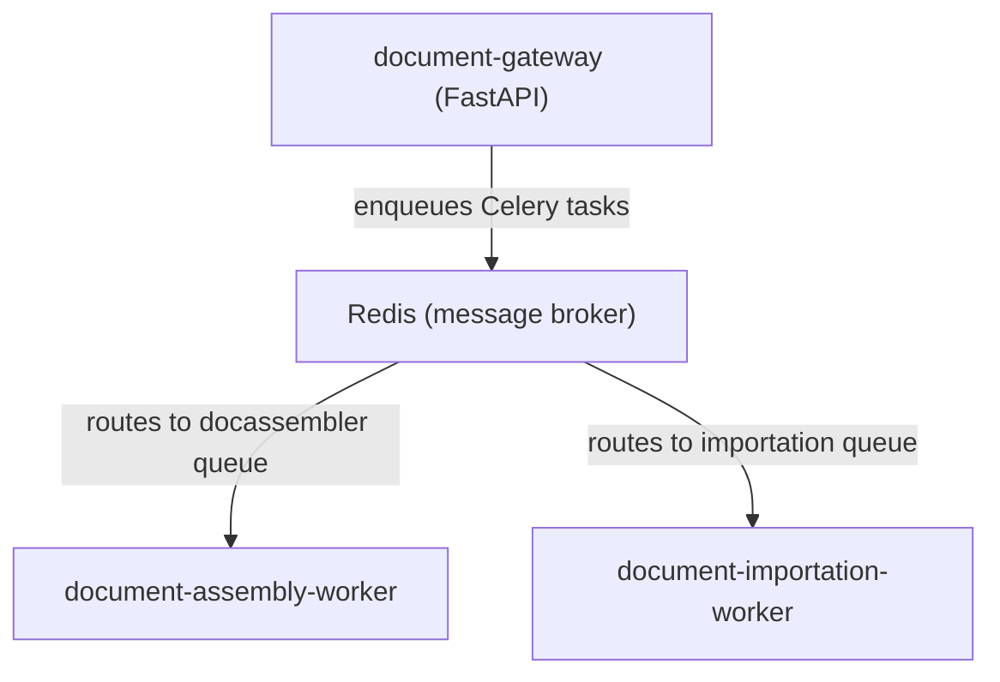

# document assembly Worker

Celery worker responsible for asynchronous document assembly in the document assembly System. It consumes `generate_document` tasks from the Redis `docassembler` queue, processes them using Haystack AI pipelines, and writes the results to the database.

This repository contains **only** the document assembly worker — not the API gateway, the importation worker, or deployment configurations. See the [document-gateway](https://gitlab.internal.instance.com/group-example/document-gateway) repositories for documentation on the overall architecture or more details on the Redis/Celery implementation.

---

## Role in the Architecture



The gateway sends a `generate_document` task with typed arguments (`template_id`, `file_ids`, `context`, `flush`). This worker picks it up and runs the full document assembly pipeline.

---

## Celery Task

### `generate_document`

Defined in [`celery_tasks/doc_assembler.py`](celery_tasks/doc_assembler.py):

```python
@celery_app.task(name="generate_document", bind=True, autoretry_for=(Exception,), retry_backoff=True, retry_kwargs={"max_retries": 3})
def generate_document_task(self, template_id: str, file_ids: List[str], context: Optional[Dict[str, str]], flush: bool) -> Dict:
    ...
```

**What the task does:**
1. Instantiates a `DocAssemblyManager`
2. Calls `create_new_document(template_id, file_ids, context, flush, job_id=self.request.id)`
3. The manager orchestrates the full assembly pipeline: loads the YAML template, resolves prompts, retrieves imported document chunks from the vector database, generates each section through Haystack pipelines with citation extraction, and writes the final document to the database.
4. Returns `{"status": "accepted", "jobId": job_id, "templateId": template_id, "coreDataIds": file_ids}` on success.

**Error handling:**
- `ValueError` (invalid template/section generator) — propagated to the gateway as a 400 response
- `FilesNotimportedException` — propagated to the gateway as a 409 response
- Other exceptions are retried automatically (up to 3 attempts with backoff)

---

## `DocAssemblyManager`

Defined in [`src/document_assembly_manager.py`](src/document_assembly_manager.py), this is the core orchestrator.

**Responsibilities:**
- Loads YAML templates and prompts into memory via `TemplateService` and `PromptService`
- Manages document stores (documents, sections, files, document chunks) through `DocumentStoreProvider`
- Tracks file importation statuses via `FileWriter`
- Generates document sections using `documentFactory` (Haystack-based pipelines with LLM calls)
- Handles document lifecycle: status transitions (`PROCESSING` → `COMPLETED` / `FAILED`)
- Flushes document stores when requested (`flush=True`)

---

## Dependencies

- **Redis**: Message broker for Celery tasks (connection configured in `celery_tasks/celery_app.py`)
- **Database backend**: Qdrant, Elasticsearch, or InMemory (configured in `config/configs/`)
- **LLM endpoint**: OpenAI-compatible API (vLLM, OpenAI, Ollama) for document assembly
- **document-common**: Shared library for schemas, services, and utilities

---

## Configuration

All configuration files are in `config/configs/`:

| File | Purpose |
|------|---------|
| `db_setup.yaml` | Database backend (`qdrant`/`elasticsearch`/`inmemory`), URL, index names |
| `llm_config.yaml` | LLM API endpoint, model name, temperature, timeout, token limits |

---

## How to Run

### Prerequisites
- Python 3.10–3.12
- Redis running and accessible
- Database backend running (Qdrant recommended)
- LLM endpoint available

### Start the worker

```bash
# Install dependencies
uv sync

# Start the Celery worker (consumes from the "docassembler" queue)
uv run celery -A celery_tasks.celery_app worker --queues=docassembler --concurrency=4 --loglevel=info
```

> **Note:** This worker does **not** expose an HTTP API. The API layer is the separate `document-gateway` service. The worker only processes tasks from Redis.

---

## Version Information

Current Version: 3.1.0
Last Updated: 2026-05-05