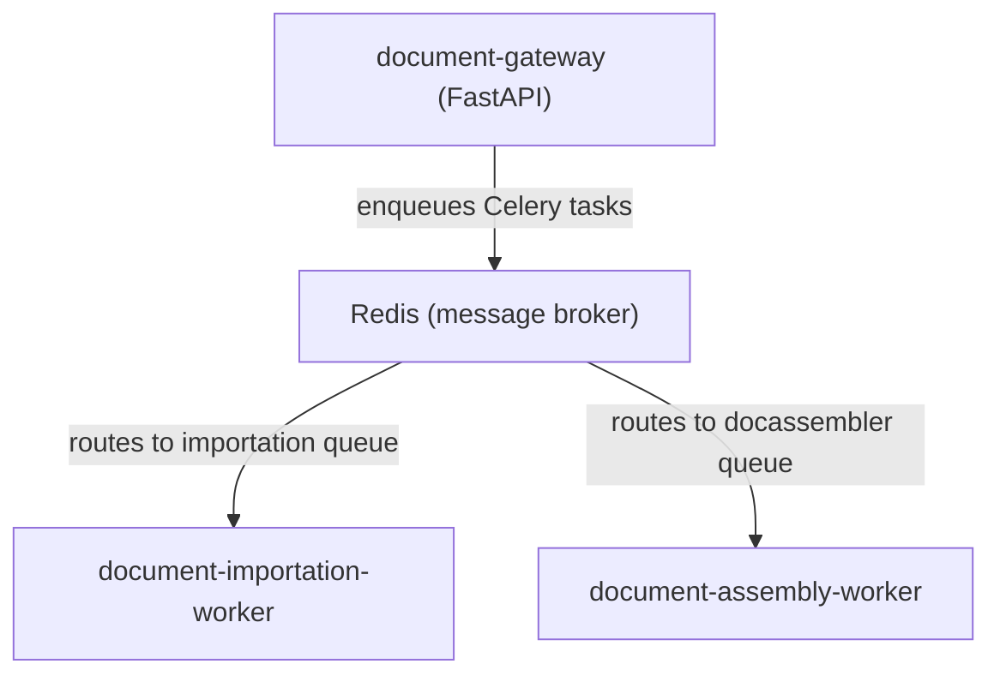

# document importation Worker

Celery worker responsible for asynchronous document importation in the document assembly System. It consumes `import_documents` tasks from the Redis `importation` queue, processes documents through a preprocessing pipeline, and stores the resulting chunks in the database.

This repository contains **only** the importation worker — not the API gateway, the document assembly worker, or deployment configurations. See the [document-gateway](https://gitlab.internal.instance.com/group-example/document-gateway) for the overall architecture or documentation on the Celery/Redis system.

---

## Role in the Architecture



The gateway sends an `import_documents` task with a list of document references. This worker picks it up, reconstructs the document objects, and runs the full preprocessing pipeline.

---

## Celery Task

### `import_documents`

Defined in [`celery_tasks/importation.py`](celery_tasks/importation.py):

```python
@celery_app.task(name="import_documents", bind=True, autoretry_for=(Exception,), retry_backoff=True, retry_kwargs={"max_retries": 3})
def import_documents_task(self, docs: List[Dict]) -> Dict:
    ...
```

**What the task does:**
1. Reconstructs `importDocRef` objects from the received document dicts
2. Instantiates an `importationManager`
3. Calls `process_files(files=imported_docs)` — an async method that runs the preprocessing pipeline
4. Returns `{"status": "completed", "coreDataIds": [doc.coreDataId, ...]}` on success

**Error handling:**
- `RequestTimeoutException` — propagated to the gateway as a 408 response
- Other exceptions are retried automatically (up to 3 attempts with backoff)

---

## `importationManager`

Defined in [`src/importation_manager.py`](src/importation_manager.py), this is the core orchestrator for document importation.

**Responsibilities:**
- Loads prompts from storage into memory via `PromptService` and `PromptProvider`
- Creates a preprocessing pipeline using a YAML-defined `PreprocessingTemplate` — this pipeline processes files through configurable stages (e.g., summarization, key point extraction, entity extraction) using `DocumentFactory` components backed by LLM calls
- Manages document stores (files and document chunks) through `DocumentStoreProvider`
- Tracks file status transitions (`importED`, `FAILED`) during preprocessing
- Embeds generated chunks when configured (`embed_chunks: true`)

---

## Dependencies

- **Redis**: Message broker for Celery tasks (connection configured in `celery_tasks/celery_app.py`)
- **Database backend**: Qdrant, Elasticsearch, or InMemory (configured in `config/configs/`)
- **LLM endpoint**: OpenAI-compatible API (vLLM, OpenAI, Ollama) for document preprocessing
- **document-common**: Shared library for schemas, services, and utilities

---

## Configuration

All configuration files are in `config/configs/`:

| File | Purpose |
|------|---------|
| `db_setup.yaml` | Database backend (`qdrant`/`elasticsearch`/`inmemory`), URL, index names |
| `llm_config.yaml` | LLM API endpoint, model name, temperature, timeout, token limits |

---

## How to Run

### Prerequisites
- Python 3.10–3.12
- Redis running and accessible
- Database backend running (Qdrant recommended)
- LLM endpoint available

### Start the worker

```bash
# Install dependencies
uv sync

# Start the Celery worker (consumes from the "importation" queue)
uv run celery -A celery_tasks.celery_app worker --queues=importation --concurrency=4 --loglevel=info
```

> **Note:** This worker does **not** expose an HTTP API. The API layer is the separate `document-gateway` service. The worker only processes tasks from Redis.

---

## Version Information

Current Version: 3.1.0
Last Updated: 2026-05-05